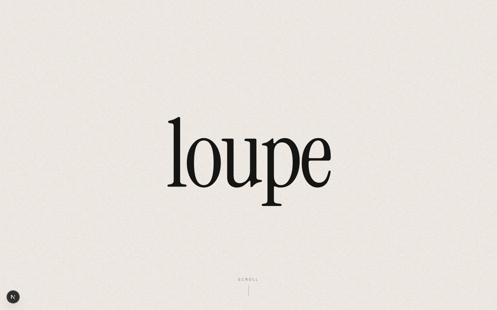

# loupe

A fashion recommendation agent for finding small, Instagram-native clothing brands.



## Why

In Korea, a lot of interesting clothing brands live almost entirely on Instagram. They sell through their own small web stores instead of big platforms like Musinsa or 29CM, so finding them means following accounts, clicking through bios, and checking dozens of separate sites by hand.

loupe does that digging for you. It crawls these brands' stores every day, keeps a catalog of their products, and recommends items and brands based on what you tell it you like.

## What it does

**Style recommendations.** Describe a look in your own words ("vintage", "Japanese girly", "clean minimal") and loupe returns tops, bottoms, and outerwear that fit, each shown with a product photo and a link to the store.

**Similar brands.** Name a brand you already like and loupe suggests others with a similar feel.

**Taste map.** Likes and saved brands are stored and shown as a map of your taste. They carry over between conversations, so recommendations get more personal over time.

**Brand digging.** When the catalog doesn't have what you're looking for, a separate workflow searches the web for new brands that aren't in the database yet.

## How it works

```
web (Next.js)  ──▶  Dify
                    ├─ recommendation chatflow
                    └─ brand-digging workflow
                           │
                           ▼
                   product + image DB (vector search)
                           ▲
                           │
                   daily crawler (brand web stores)
```

- The **web app** handles chat, product cards, the taste map, and brand pages.
- **Dify** runs the agent logic. The chatflow pulls candidates from the product DB and an LLM writes the answer. The digging workflow uses Tavily Search to find new brands.
- A **daily crawler** visits each brand's store and adds new products incrementally. Only tops, bottoms, and outerwear are collected for now.
- All LLM calls go through OpenRouter using `gpt-5-mini`.

Recommendations are drawn only from products that actually exist in the catalog. Earlier versions searched the web live on every question, which was slow, expensive, and led the model to make up products. Moving to a pre-built catalog fixed both problems.

## Repository layout

| Path | Contents |
|---|---|
| `web/` | Next.js app, built on Dify's webapp-conversation template |
| `dify/` | Dify app exports. `fashion-bot-live.yml` is the recommendation chatflow and `brand-dig.yml` is the digging workflow. The numbered files are older versions. |
| `dify_nodes_v5/` | Source for the Dify code nodes (candidate selection, formatting, prompts) and the script that assembles them into the app |
| `eval/` | Evaluation script and before/after results from recommendation quality fixes |
| `shots/` | Screenshots, desktop (`d-`) and mobile (`m-`) |

The crawler and database are not included in this repository.

## Running locally

**1. Set up the Dify apps**

In Dify, use *Import DSL* to load `dify/fashion-bot-live.yml` and `dify/brand-dig.yml`, then add your OpenRouter and Tavily API keys to each app.

**2. Run the web app**

```bash
cd web
npm install
cp .env.example .env.local   # fill in your Dify app keys and API URL
npm run dev
```

Then open `http://localhost:3000`.

`.env.local` contains API keys and is ignored by git. Don't commit it.

## What's next

- **Taste from photos.** Upload a few outfit photos you like and get a written breakdown of color, fit, material, and mood that feeds into recommendations.
- **Outfit recommendations.** Browse brand lookbook photos, tap an item to see similar products, and get more outfits based on what you like.
- **Going global.** Introducing Korean Instagram brands to shoppers outside Korea.

## License

`web/` is based on [langgenius/webapp-conversation](https://github.com/langgenius/webapp-conversation). See `web/LICENSE` and `web/THIRD_PARTY_NOTICES.md` for the original license terms.
